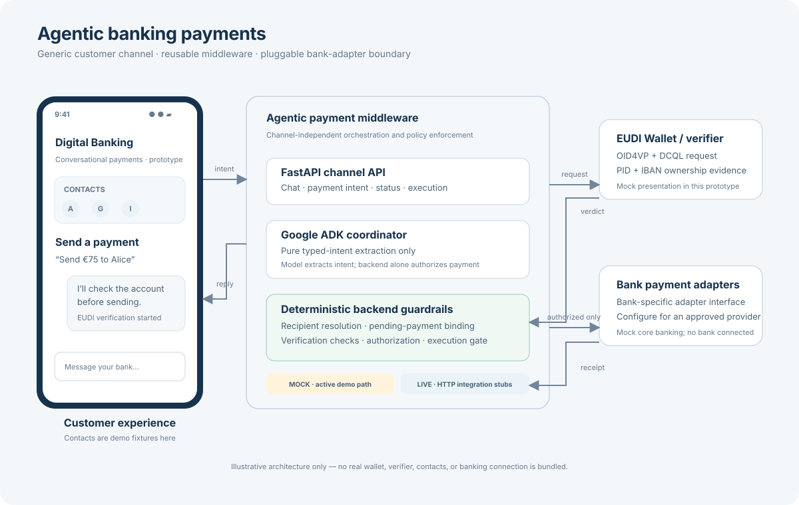

# Agentic Banking Payments — EUDI Middleware Prototype

A conversational payment experience backed by an agentic middleware prototype. The middleware extracts payment intent, applies deterministic policy, coordinates EUDI Wallet verification, and calls a payment adapter only after backend authorization.

> **Prototype only.** The included wallets, verifier results, issuer recovery and core-banking adapter are simulations. The `LIVE` HTTP adapters are integration stubs, not a certified EUDI verifier or production banking integration. Do not use this repository to move real funds or deploy it as a production service.

## Architecture



The phone-shaped UI uses generic banking branding and is not affiliated with or connected to any financial institution. The EUDI panel beside the phone is a developer-side simulator to make the middleware handoff visible; it is not part of the customer’s real mobile-wallet experience. Demo contacts are local fixture data, not connected to a bank address book.

### Payment flow

1. The customer describes a payment in the mobile-style chat or picks a demo contact.
2. FastAPI sends the message to the Google ADK coordinator. Its intent specialist returns structured payment data; the model does not authorize or execute payments.
3. Deterministic backend code resolves a configured/mock recipient, records the pending payment and applies the trusted-recipient policy.
4. For a payment requiring step-up, the verifier adapter creates an OID4VP/DCQL request. The demo wallet presents synthetic PID and IBAN-attestation claims.
5. Backend validation returns a status. Only a fresh, matching `VERIFIED` result—or the separately configured exact trusted-recipient fast path—can pass the execution guard.
6. The payment adapter returns a demo receipt, visible in the wallet evidence panel.

## Components

| Component | Location | Responsibility |
| --- | --- | --- |
| Mobile banking prototype | `frontend/` | Phone-shaped chat, sample recipients, payment status and wallet simulator UI |
| FastAPI API | `backend/app/main.py` | Chat, payment intent, verification, execution, and mock-wallet routes |
| ADK coordinator and specialists | `backend/app/agents/` | Intent extraction, risk, EUDI status, and execution coordination |
| Deterministic payment guardrails | `backend/app/tools/payment_tools.py` | Recipient resolution, pending state, authorization checks and payment-adapter call |
| Domain validation | `backend/app/domain/` | Typed models and synthetic credential checks |
| Adapter boundary | `backend/app/adapters/` | Mock implementations and illustrative HTTP integration stubs |

## Run locally

### Backend

Requirements: Python 3.12+ and [`uv`](https://docs.astral.sh/uv/).

```bash
cd backend
cp .env.example .env
uv sync
uv run uvicorn app.main:app --host 127.0.0.1 --port 8080 --reload
```

Set `GEMINI_API_KEY` in your local, ignored `.env` to enable ADK conversational extraction. Without it, the chat endpoint safely reports that extraction is unavailable; structured intents can still be submitted via the API. Never commit `.env` or paste a real key into source control, logs, or chat.

### Frontend

In a second terminal:

```bash
cd frontend
npm ci
cp .env.example .env
npm run dev
```

Open `http://localhost:5173`. The frontend defaults to the local API at `http://localhost:8080`; set `VITE_API_BASE_URL` in the ignored frontend `.env` to override it.

## Demo configuration

The safe local defaults in `backend/.env.example` use mock adapters. In particular:

- `ADAPTER_MODE=MOCK` selects synthetic verifier and payment adapters.
- `MOCK_WALLET_AUTO_PRESENT=false` leaves wallet presentation as a manual demo action.
- `ALLOW_MOCK_VERIFICATION=true` permits mock verification in the demo only.
- `AUTO_EXECUTE_VERIFIED_PAYMENTS=true` demonstrates automatic execution after an accepted demo verdict.

These flags do **not** make the sample safe for real banking use. Mock signatures/statuses and the local fixture are not cryptographic proof. The mock recovery button simulates issuer recovery locally.

## Test and build

```bash
cd backend
uv run pytest

cd ../frontend
npm ci
npm run build
```

The tests cover payment guardrails, mock wallet outcomes, recipient resolution, intent handoff and English user-facing responses. They do not certify OID4VP/OID4VCI conformance or a real issuer/verifier integration.

## API overview

With the backend running, use `http://localhost:8080/docs` for the interactive API reference.

- `POST /api/chat` — conversational payment request.
- `POST /api/payment-intents` — structured intent fallback.
- `POST /api/payments/{session_id}/verification` — check verifier status.
- `POST /api/payments/{session_id}/execute` — attempt guarded execution.
- `/mock-wallet/...` — development-only presentation, preset, recovery and receipt routes.

The current demo API has no customer authentication/session ownership layer. Do not expose it to untrusted networks.

## Live integration work still required

Before any real-money or production use, replace the illustrative adapters and demo UI with bank-approved integrations and complete at least:

- authenticated API access, customer/session ownership and least-privilege authorization;
- a supported EUDI verifier/profile, configured issuer trust anchors, credential status/revocation checks and authenticated service-to-service transport;
- request-bound nonce, audience, expiry and replay protection, plus one-time verification semantics;
- account-holder binding based on the applicable credential profile (do not assume identifier semantics without that profile);
- customer-bound debit-account selection and idempotent payment execution;
- production secrets management, rate limiting, audit controls, monitoring, and security/privacy review.

See [`integration.md`](integration.md) for the live integration checklist and [`backend/README.md`](backend/README.md) for backend details.